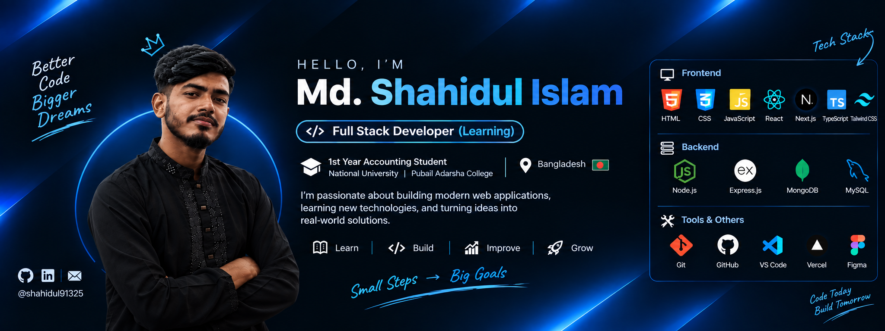

 

 

# 👋 Hi, I'm MD Shahidul Islam

### 💻 Full-Stack Web Developer | 🎓 Accounting Student | 🇧🇩 Bangladesh

  
  
  

  

---

## 👨‍💻 About Me

I'm **MD Shahidul Islam**, a developer from Bangladesh focused on building modern, responsive web applications with React and Next.js.

🎓 I'm studying Accounting at Pubail Adarsha College under National University while independently developing my software engineering skills.

💡 I enjoy building practical applications, integrating APIs, creating responsive user interfaces, and continuously improving my coding skills through hands-on projects.

🎯 **Career Goal:** To grow as a Full-Stack Web Developer and contribute to real-world software products.

🌐 **Portfolio:** [md-shahidul-portfolio.vercel.app](https://md-shahidul-portfolio.vercel.app/)

> **Learn → Build → Improve → Grow 🚀**

---

## 🚀 What I Do

- 🌐 Build responsive web interfaces
- ⚛️ Develop applications using React.js
- ▲ Create modern web applications with Next.js
- 🎨 Design responsive UI using Tailwind CSS
- 🔌 Integrate APIs and manage application data
- 🧠 Practice JavaScript and TypeScript
- 🔐 Learn authentication and authorization
- 🔧 Use Git and GitHub for version control
- 🗄️ Develop my backend and database skills

---

## 🧰 Tech Stack

### 🎨 Frontend

  

### ⚙️ Backend

  

### 🗄️ Database

  

### 🛠️ Tools

  

---

## 📂 Featured Projects

### 🛒 Bazar Dor — Essential Product Price Tracker

A web application focused on helping users explore essential product prices and compare market information in Bangladesh.

- **Tech:** Next.js, React, TypeScript, Tailwind CSS, API integration
- 🌐 [Live Demo](https://bazar-dor-web.vercel.app/)
- 💻 [GitHub Repository](https://github.com/shahidul91325/Bazar-Dor-Web)

### 🏋️ FitLog — Workout Management Web App

A responsive workout application for exploring workouts and managing workout plans.

- **Tech:** Next.js, React, TypeScript, Tailwind CSS
- 🌐 [Live Demo](https://fit-log-web-3piv.vercel.app/)
- 💻 [GitHub Repository](https://github.com/shahidul91325/Fit-Log-Web)

### 💻 Dev Stack — Developer Resource Website

A web project showcasing developer-focused content and modern web development practices.

- 🌐 [Live Demo](https://my-firsht-dev-stack-project.netlify.app/)
- 💻 [GitHub Repository](https://github.com/shahidul91325/dev-stack-web)

---

## 📚 Currently Learning

- Strengthening JavaScript fundamentals
- Building better React and Next.js applications
- Improving TypeScript skills
- Learning Node.js and Express.js
- Building and consuming REST APIs
- Understanding authentication and authorization
- Practicing database operations
- Improving problem-solving and clean-code practices

---

## 🎯 Career Goals

I'm working toward becoming a professional Full-Stack Web Developer. I'm interested in opportunities that help me learn, collaborate, and contribute to real-world software projects.

**Target Roles:**
- Full-Stack Developer
- Frontend Developer
- Junior Backend Developer
- Junior Web Developer
- Junior Software Engineer

I'm open to suitable entry-level opportunities, internships, mentorship, and collaborative projects.

---

## 🎓 Education

- **Honours in Accounting** — Pubail Adarsha College, National University *(Ongoing)*
- **HSC, Science** — Dhaka Northern City College
- **SSC / Vocational, Electronics** — Sir Uddin Sarker Vidyaniketan & College, 2023

---

## 📊 GitHub Stats

 

 

---

## 🤝 Connect With Me

---

### 💻 Learn. Build. Improve. Grow. 🚀

**Code Today • Build Tomorrow • Dream Bigger**

